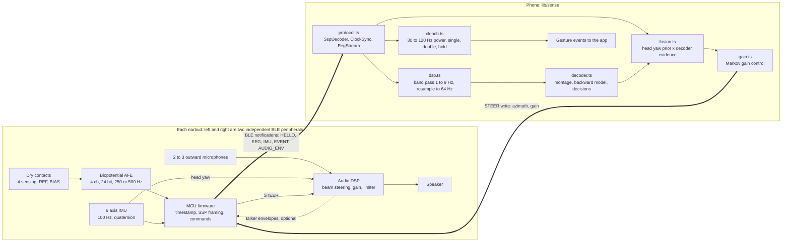

# Architecture

How a sample travels from the ear to a decision and back to the sound, what runs where, how
long each path may take, and what happens when something fails. Requirements are in
[SPEC.md](SPEC.md); the wire format is [PROTOCOL.md](PROTOCOL.md).

## Data flow

**The walk, in order.**

1. **Contacts to AFE.** Four sensing contacts are measured against REF in the same ear while
   BIAS drives that ear's common mode (SPEC section 3). 24 bit samples at 500 Hz, or 250 Hz
   when the phone asks for it.
2. **AFE to MCU.** The MCU captures each data ready edge on a hardware timer clocked from the
   radio's crystal, packs 18 samples of 4 channels into one 234 byte EEG frame (36 ms of data
   at 500 Hz), packs IMU samples five to a frame, and numbers every frame. It decides nothing.
3. **BLE.** One frame per notification, ATT MTU 247, 2M PHY where the phone supports it, an
   encrypted link per earbud. 9.3 kB/s per earbud at 500 Hz (SPEC HW-BLE-02).
4. **Phone, protocol.ts.** Checks the CRC, tracks sequence gaps, unwraps each earbud's clock
   and maps both onto the phone's clock (`ClockSync`), and fills lost samples with NaN at
   their true positions instead of shifting the rest (`EegStream`).
5. **Phone, dsp.ts and decoder.ts.** Causal band pass 1 to 9 Hz at the electrode rate,
   resampling to 64 Hz, the montage (each ear referenced to itself), unit variance scaling,
   then a linear backward model over 32 lags (half a second) that rebuilds the attended
   speech envelope. Over a decision window, the talker whose envelope correlates best wins.
   The talker envelopes and azimuths come from the earbud as AUDIO_ENV (optional in SSP v0);
   this is the one place where the audio DSP feeds the decoder.
6. **Phone, fusion.ts.** Head yaw from the IMU sets a prior around where the head points; the
   decoder's margin adds evidence for one talker; the product is a probability per talker.
7. **Phone, gain.ts.** A Markov chain moves one step toward each decided talker (Geirnaert et
   al. 2019), so no single decision is trusted. The phone writes one STEER (azimuth of the
   favoured talker, gain in 0.1 dB) to both earbuds.
8. **Earbud, audio DSP.** Beams toward the STEER azimuth, keeps following that talker as the
   head turns using its own IMU, ramps the gain, limits the output, and drives the speaker.
   Sound never leaves the earbud.
9. **In parallel, clench.ts.** Per side, 30 to 120 Hz power averaged over that side's
   contacts, as a 50 ms RMS against an adaptive floor. Both sides above 4 times their floor
   for 40 ms is a burst; bursts become single, double or hold; four bursts within 3 s is
   chewing and silences events for 2 s. Events go to the app (capture, undo, ask).

## Latency budget

| Path | Stages | Budget | Runs on |
|---|---|---|---|
| Steered audio | Microphone, decimation, beamformer, gain, DAC, speaker | ≤ 5 ms target, ≤ 10 ms maximum (SPEC HW-AUD-02) | Earbud only |
| Beam follows a head turn | IMU to audio DSP, beam update | ≤ 20 ms target (to verify on the nRF5340 Audio DK) | Earbud only |
| Head orientation to a new STEER | IMU frame of 5 samples at 100 Hz (50 ms), BLE (≤ 30 ms connection interval), fusion, STEER write (≤ 30 ms), gain ramp | ≤ 150 ms target | Earbud and phone |
| EEG attention decision | EEG frame (36 ms at 500 Hz, 72 ms at 250 Hz), BLE, causal filter, half a second of lags after the window, the decision window itself (2 to 60 s), then one gain step per decision | Seconds to minutes. The first pass on public data puts the median minimal expected switch duration near two minutes ([research/aad/README.md](../research/aad/README.md)) | Phone |
| Clench to event | EEG frame (36 or 72 ms), BLE (≤ 30 ms, more with retries), 50 ms RMS and 40 ms onset, then the 450 ms double window after release | Hardware share ≤ 100 ms. A single is final about 0.45 s after the clench ends, so under about 0.6 s from release to event; about 0.65 s after the onset of a 200 ms clench plus transport ([clench.ts](../lib/sense/clench.ts)). A hold is reported 0.7 s after onset by definition | Earbud and phone |

The EEG row is why the IMU matters. Two second decisions barely beat a coin flip on the public
cEEGrid data, while five minute evidence reaches about 85% ([research/aad/README.md](../research/aad/README.md)).
Head orientation steers in tens of milliseconds; the EEG says, over minutes, who the wearer
keeps coming back to; the clench is the explicit command. The client's design target of a
decision window under 2 s ([lib/copy.ts](../lib/copy.ts), science block) is not met by the
EEG alone on today's data; the orientation path is what makes the system respond inside it.

## What runs where, and why

| Where | What | Why |
|---|---|---|
| Earbud firmware (MCU) | Sample AFE and IMU, timestamp, SSP framing, the five commands, lead off, wear and battery events | Thin and stable: no model and no thresholds, so it rarely needs an update over the air, and it is checked byte for byte against the golden stream ([firmware/](firmware/)) |
| Earbud audio DSP | Beam toward the STEER azimuth, follow the talker with the IMU, gain ramps, limiter, optional talker envelopes | Sound cannot make a round trip through the phone inside the 10 ms budget (SPEC HW-AUD-01) |
| Phone ([lib/sense](../lib/sense/)) | Gap handling and clock sync, filtering, resampling, montage, decoder, fusion, gain policy, clench detection | Everything that changes ships with the app; the phone has the compute; EEG stays on the phone by default (SPEC HW-REG-08) |
| Cloud | Nothing by default | Neural data privacy; only with the wearer's explicit opt in |

Why the clench detector is on the phone: the 450 ms wait for a possible double dominates its
latency, so moving it into the earbud would save only the transport, under 0.1 s, and would
put thresholds into firmware. Revisit only for a low power mode that turns EEG streaming off
but keeps the clench available.

## Failure modes and fallbacks

| Failure | Detected by | What happens |
|---|---|---|
| One earbud drops (link lost, battery empty, taken out) | BLE disconnect; WEAR 0; no frames from that side | The decoder continues on one ear (the single ear rows of SPEC section 3 show what that costs). Orientation steering continues. The current `ClenchDetector` needs both sides by design (a one sided spike, such as a finger on one earbud, is not a clench), so the clench is unavailable until a single side mode exists: a software follow up. The remaining earbud keeps its last STEER, and its button and the phone take over commands |
| One contact loses contact | LEAD_OFF flag and EVENT; saturated counts (±8388607); impedance check | That channel becomes NaN and the montage is re-derived over the remaining contacts of that ear. With fewer than 2 left the ear average montage no longer exists ([pipeline.py](../research/aad/pipeline.py)), so that ear contributes at most its remaining channel against REF. The clench needs only 1 contact per side |
| REF or BIAS loses contact | Every channel of that ear saturates or fills with mains | That ear's EEG is dropped; the phone asks the wearer to reseat the earbud |
| Motion, chewing, talking | Band C power on both sides; the chewing rule | Gestures are suppressed during chewing; decoder windows with heavy muscle activity should count for less (software); orientation carries the steering |
| Phone link lost on both earbuds | No connection; no STEER | Each earbud holds its steering, then ramps to neutral hear-through after 10 s (SPEC HW-AUD-04). Frames that overflow the queue are dropped and flagged DEVICE_DROP; on reconnect the phone asks for a HELLO |
| Low battery | BATTERY event every 10 s | At 20% the phone drops to 250 Hz; at 10% it stops EEG and keeps hear-through and the IMU; at cutoff the earbud ramps to neutral and shuts down (SPEC HW-PWR-05) |
| Radio congestion | Sequence gaps; DEVICE_DROP | NaN at the true positions; the phone may lower the EEG rate |
| Audio DSP fault | Watchdog | Plain passthrough at neutral gain, never a steered or silent ear |

**The fallback that always works is orientation plus manual control.** With no EEG at all,
fusion reduces to the head orientation prior, so the earbud steers toward whoever the wearer
faces; the wearer can override by choosing a talker in the app or with the earbud button,
and the gestures still work while both earbuds are in. Every EEG failure above degrades to
this, not to silence.

## Open architecture questions

1. **Production audio SoC.** Nordic nRF5340 with a Cirrus CS47L63 has open tools and an
   evaluation kit, but plays music only over LE Audio. A dual mode audio SoC (Qualcomm,
   Airoha, Bestechnic, Realtek) also covers Classic A2DP, but its SDK sits behind vendor
   approval and NDAs ([BOM.md](BOM.md)). Decide with the ODM before Rev C.
2. **Ear to ear audio link.** Combining both earbuds' microphones gives a head wide array and
   better talker localisation, at the cost of a low latency link between the ears. Not in v0:
   each earbud steers with its own microphones.
3. **Source of talker envelopes.** AUDIO_ENV from the earbud (SPEC HW-AUD-07) is the plan; it
   needs per talker beams in the DSP.
4. **Split ground electrics.** Whether two floating earbuds pick up more interference than
   the software montage predicts (SPEC T-08).
